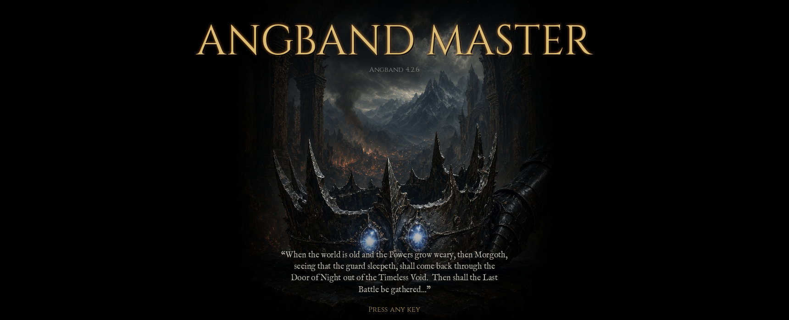
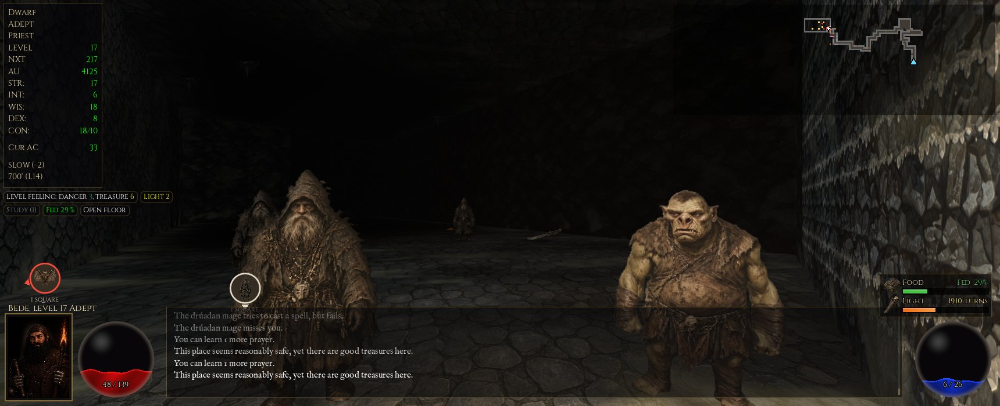
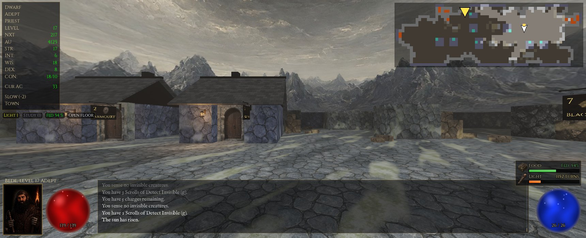
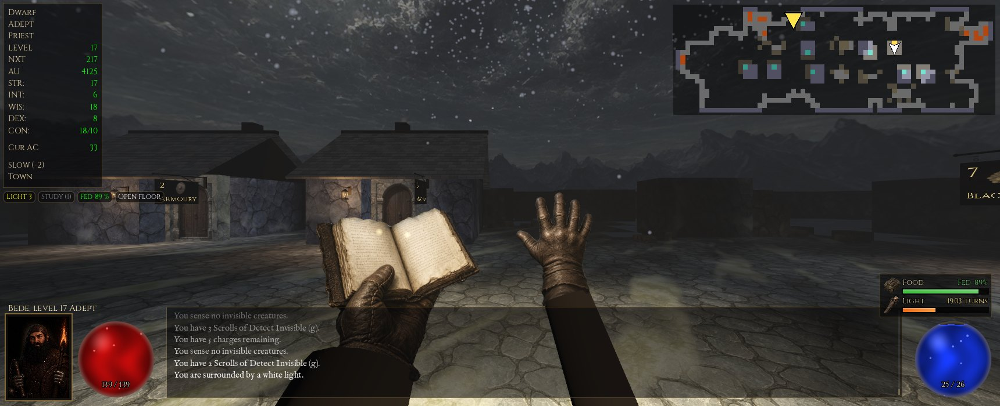
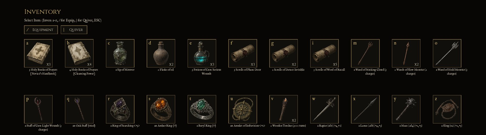

# Angband Master

**Angband, played the Dungeon Master way.** The whole of Angband's dungeon,
in first person, with an overhead map always in view.

This isn't a remake. The real Angband 4.2 engine runs underneath, unchanged
in its rules: the same monsters, items, spells, classes, level generation
and decades of balance. A new front end reads the live game and draws it in
3D, in the spirit of Dungeon Master and Legend of Grimrock.

In development. The game and its source will be published here.

## What's different from playing Angband

- **A first-person view** of the dungeon: torch-lit stone, doors, stairs,
  rubble, caves and vaulted rooms, built from Angband's own map as you
  explore it.
- **An overhead map always in view**, drawn as an explorer's map on
  parchment, with the monsters as small tokens of their pictures, and a big
  one (F3) you can click to walk to a spot. Markers at the edges of the
  view show monsters beside or behind you.
- **Painted monsters** standing in the world, each of Angband's 600-odd,
  rounded out so they have some body. The monsters of the first thirty
  levels move, standing and walking, and many monsters have a death of
  their own.
- **Pictures for every item** and every named artifact, in picture screens
  for your inventory, equipment and the shops (whose keepers are painted too).
- **Your own hands** holding your spell book as you cast, and your weapon as
  you fight (dwarves' so far; the other races' are to come).
- **The town** with its shops, day and night, and weather: rain, storms,
  snow and fog.
- **Sound**: footsteps, doors, blows, spells, monsters, the dungeon around
  you, and title music.
- **A portrait of your character** beside health and mana orbs, or
  Angband's own text if you prefer it.

Angband's own screens, menus and messages are all still there, so everything
in the game works as it always has.

## Controls

Every key goes to Angband as usual, except these:

- **Dungeon Master style** (the default): the number pad moves relative to
  the way you face (8 forward, 2 back, 4 and 6 sidestep, 7 9 1 3
  diagonals, 5 stays still). The left and right arrows turn 45 degrees; up
  and down step forward and back.
- **Angband style** (F2 switches between them): the number pad and arrows
  move as in Angband (8 is always north), and the view turns to face each
  step.
- **Shift** with a movement key runs.
- **F3**: the big map (click it to walk there; Escape or F3 closes it).
- **The small map**: click a square to walk there; the mouse wheel over it
  zooms out to the whole level and back; click its compass to have it turn
  with you (the way you face is up) or stay north up.
- **F4**: the haze in unexplored openings, on or off.
- **F5**: portrait and orbs, or Angband's text.
- **F6**: sound on or off.
- **F7**: who paints your portrait as you play, Grok or your own computer
  (painting as you play is optional, and off at first).
- **F8**: the small map on or off.
- **F9**: pause when hurt, on or off (on at first): each time you're hurt
  with hit points below the warning level, keys wait half a second, so
  keys pressed in a hurry don't carry on regardless. Apart from that, a
  held key always stops repeating when a monster comes into view or you're
  hurt, as Angband stops running; press it again to go on.
- **Hold Alt**: make the items lying around sparkle, to spot loot.

## Supporting Angband Master

Angband Master is free and always will be. Its pictures, monster clips,
sounds and music are paid for as they're made, so if you enjoy it and
would like to help with those costs, you can buy me a coffee at
[ko-fi.com/wolfang42](https://ko-fi.com/wolfang42). Thank you, and never
required.

## Credits and licence

Angband is the work of the Angband Dev Team and everyone who has worked on
it since 1990. Most of Angband Master's pictures and clips were made with
xAI's Grok Imagine, and many of its sounds and its music with ElevenLabs;
the rest of the sounds come from free packs (Kenney, artisticdude,
rubberduck, p0ss and others), all credited in full with the source.

Angband is released under the GNU GPL version 2 or the Angband licence;
because Angband Master builds on it, Angband Master will be released under
the GNU GPL version 2. It is free to play (donations are welcome, never
required) and not affiliated with the Tolkien Estate or Middle-earth
Enterprises.
